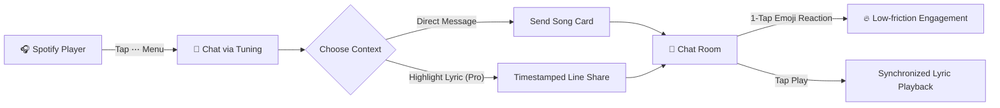

# 🎵 Tuning — A Musical Language for Social Communication
> *What if music was your message?*

---

## 📌 Executive Summary
**Tuning** is a social communication layer built on top of the Spotify streaming ecosystem. Instead of forcing users out of their listening experience to copy-paste links into WhatsApp or Instagram, Tuning turns songs, timestamped lyrics, and lightweight emoji reactions into primary communication units.

Built as a high-fidelity interactive mobile prototype using **React 19, TypeScript, and Motion**, accompanied by an industry-standard **Product Requirements Document (PRD)** and **SQL Schema**.

---

## 🚨 The Friction: Why Music Sharing is Broken Today

| Existing Friction | Current User Workaround | Tuning's Native Solution |
| :--- | :--- | :--- |
| **Silent Share Links** | User copies URL, leaves Spotify, pastes link in WhatsApp | One-tap **"Chat via Tuning"** drawer inside the listening experience |
| **Context Loss** | Receiver clicks link, opens app, loses whatever they were listening to | **Non-destructive previews** and contextual chat bubbles |
| **"This Exact Line is for You"** | User screenshots lyrics or manually types timestamps ("listen from 1:42") | **Timestamp Lyric Highlighting (Pro)** — playback begins directly at the intended line |
| **Typing Fatigue** | Receiver has to type a full reply to acknowledge a 3-minute track | **Instant 1-Tap Emoji Reactions** directly on song bubbles |

---

## 🔄 User Journey & Product Flow

---

## 🧪 Quick 30-Second Live Prototype Walkthrough
You can test the functional prototype live at **[ashokkumarone.github.io/Tuning-Music](https://ashokkumarone.github.io/Tuning-Music/)**:

1. **Explore the Player:** Browse songs, hit play, and inspect the synchronized lyrics view.
2. **Test Tuning Share:** Tap the **⋯** menu or the message button to trigger the Tuning conversation drawer.
3. **Experience Timestamp Sharing:** Select a specific lyric timestamp to experience how receiver playback synchronizes.
4. **Low-Friction Reaction:** Test one-tap emoji reactions without opening a virtual keyboard.

---

## 💎 Freemium Monetization Architecture

| Feature | Free Tier | Pro Tier (₹99/mo / $1.99) | Strategic PM Rationale |
| :--- | :---: | :---: | :--- |
| **Native Song Sharing** | ✅ | ✅ | **Acquisition engine:** Drives organic network effect |
| **Instant Emoji Reactions** | ✅ | ✅ | **Retention engine:** Removes keyboard friction |
| **Shared Chat Themes** | ✅ | ✅ | Personalization & emotional attachment |
| **Timestamp Lyric Sharing** | ❌ | ✅ | **Conversion driver:** Power feature for expressive sharing |
| **Emotion Buckets** | ❌ | ✅ | Curated emotional tags for songs |
| **Ad-Free Social Experience** | ❌ | ✅ | Standard monetization baseline |

---

## ⚔️ Competitive Landscape & Differentiation

| Dimension | WhatsApp / iMessage Share | Apple Music SharePlay | Instagram Music Stickers | Tuning (Our Concept) |
| :--- | :--- | :--- | :--- | :--- |
| **Context** | External link; no player integration | Synchronized call (heavyweight) | 15s ephemeral story | **Integrated chat layer directly inside Spotify** |
| **Effort** | High (Switch apps + copy link) | High (Requires FaceTime call) | Medium (Story editor) | **Low (1-tap in-stream sharing)** |
| **Lyric Highlighting** | ❌ None | ❌ None | ⚠️ Static text only | **✅ Dynamic timestamp playback** |
| **Reaction Loop** | Generic text or basic emoji | Audio chatter | DM response only | **Song-specific music emoji reactions** |

---

## 📊 Key Product Metrics & Target KPIs

| KPI Metric | Target | Strategic Significance |
| :--- | :--- | :--- |
| **Daily Active Sharers (DAS)** | **20% of DAU** | Measures adoption of the primary sharing loop |
| **Reaction Velocity** | **40%+** within 5 mins | Validates the low-friction communication hypothesis |
| **Lyric Timestamp Usage** | **15% weekly** | Proves willingness to pay for emotional granularity |
| **Free ➔ Pro Conversion** | **5% in 60 days** | Validates freemium revenue sustainability |
| **Viral Coefficient ($K$)** | **> 1.2** | Ensures organic, non-paid social growth loop |

---

## 📁 Repository Structure & Documentation

- 📄 **[Product Requirements Document (PRD)](./Tuning_Product_Requirements.md):** Deep-dive into user stories, technical constraints, phase rollouts, and KPI frameworks.
- 🗄️ **[Database Architecture (schema.sql)](./schema.sql):** Production-ready schema covering `Users`, `Songs_Meta`, and `Tuning_Logs`.
- 💻 **`src/`:** Fully modular React 19 + TypeScript implementation with interactive phone container.

---

*Concept created by [Ashokkumar S](https://linkedin.com/in/ashokkumarone) · Portfolio: [ashokkumarone.github.io](https://ashokkumarone.github.io/)*
